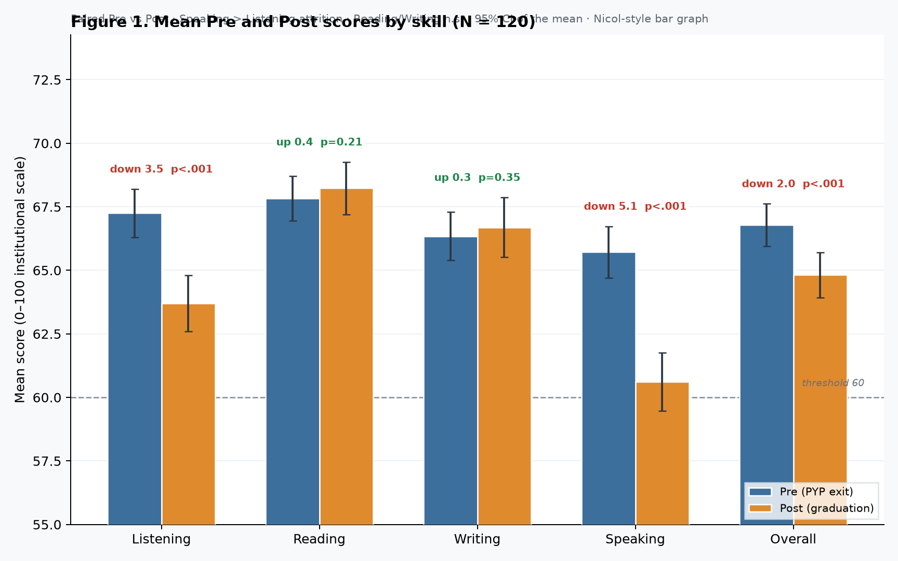

# English-Medium Instruction and Oral–Aural Attrition:
## Methodology and Quantitative Results

Explanatory sequential mixed methods (QUANT → QUAL) · Synthetic N = 120 completer panel (scaffolding; replace with live institutional data). Quantitative strand = **RQ1 only** (paired Pre/Post). Qualitative strands (RQ2–RQ3) are scoped below and developed next.

*Author note.* Values are from a calibrated synthetic panel for method demonstration—not findings from real students. Tables follow Nicol & Pexman Play-It-Safe formats.

## Research questions

**RQ1 (Quantitative).** To what extent do students’ institutional English proficiency scores change from PYP exit to graduation after four years of engineering EMI, across Listening, Reading, Writing, Speaking, and Overall?

**RQ2 (Qualitative — students).** To what do students attribute their oral–aural attrition? Semi-structured follow-up, not a separate question: *Why do you think lecturers use Turkish so often?* Prepared in advance from the researcher’s observation of these classrooms over several years, and asked after the open answer.

**RQ3 (Qualitative — lecturers).** When lecturers use L1, what do they say underlies that use?

## Methodology

### Research design

The study adopts an **explanatory sequential mixed-methods** design (Creswell & Plano Clark, 2018). Phase 1 (quantitative) uses a longitudinal completer panel: the same engineering EMI students sat parallel institutional academic English tests at (a) PYP exit (pretest) and (b) graduation after four years of EMI (posttest). Paired comparisons establish whether proficiency changed and in which skills. Phase 2 (qualitative; forthcoming) will interview lecturers and students to explain oral–aural attrition through accounts of translanguaging, materials difficulty, and lecturer/student English use. The qualitative phase is deliberately reserved until after the quantitative comparison is fixed.

### Setting

Turkish public-university engineering faculty with an English Preparatory Year Programme before EMI content courses. Progression requires a minimum overall of **60/100** on the institutional test (≈ CEFR B1). Classroom practice often includes Turkish (translanguaging); that practice is treated here as a phenomenon to be explained qualitatively, not modelled statistically in Phase 1.

### Participants (quantitative)

Analytic sample: *N* = 120 EMI engineering completers with both Pre and Post scores (synthetic demonstration panel). Gender ≈ faculty profile (82 male, 38 female). Majors balanced across Mechanical, Chemical, and Electrical-Electronics Engineering.

### Instrument

Institutional academic English test covering Listening, Reading, Writing, and Speaking on a **0–100** scale; Overall = unweighted mean of the four skills. Graduation form = parallel form (same blueprint/rubrics; different items). Writing and Speaking marked by three raters (testing expert + two PYP instructors); official skill score = mean of three marks.

### Quantitative data analysis (RQ1 only)

Because RQ1 asks whether **each** skill (and Overall) changed from Pre to Post, the primary analyses were **paired-samples *t* tests** with Wilcoxon signed-rank companions, Cohen’s *d_z*, and 95% CIs for mean differences (Nicol & Pexman, 2010a, *t*-test Play-It-Safe format). Difference-score normality was inspected with Shapiro–Wilk. **MANOVA / RM-ANOVA were not used as the lead analysis:** a multivariate omnibus would still require skill-wise follow-ups and would add tables without answering skill-specific change more clearly. For publishing economy, results are limited to two Play-It-Safe tables and **one** grouped Pre–Post bar figure with 95% CIs (Nicol & Pexman, 2010b, bar-graph guidance). No mechanism regressions, mediation, or translanguaging indices enter the quantitative strand.

### Qualitative strand (RQ2–RQ3; next)

Phase 2 uses semi-structured interviews. Student interviews open with RQ2: to what they attribute their oral–aural attrition. Other accounts, including reliance on written technical discourse, can surface there without a prompt. A prepared follow-up is then asked of each student: *Why do you think lecturers use Turkish so often?* This is not a second research question. It was written in advance because the researcher had observed frequent lecturer use of Turkish in these EMI classrooms over several years and expected that practice to be offered as an account of attrition. If the student has already mentioned Turkish, the follow-up probes that remark. If not, it is still asked and reported as a planned question.

The follow-up was prepared for two anticipated accounts, not a longer list. The first is lecturers’ limited English for sustained EMI teaching. The second is lecturers’ underrating of students’ English. Protecting content because Turkish is the shared first language is treated as part of that second account, not as a third theme. Lecturer interviews (RQ3) ask what underlies their own use of L1. From the same extended observation, lecturers are expected to cite only students’ low proficiency, not their own English. That answer is interpreted as a Golem effect. They are not expected to reflect on their own spoken English. When their proficiency is raised, the expected account is that they have already validated it by a proficiency test required for English-medium teaching. In this setting that credential is typically a national multiple-choice examination such as YDS or YÖKDİL: reading-based items on grammar, vocabulary, and the meaning of texts, with no Listening or Speaking component (ÖSYM). The test therefore does not evidence the oral–aural proficiency EMI teaching requires. Thematic analysis follows once these quantitative results are locked.

## Quantitative results (RQ1)

### Preliminary descriptives

All 120 completers met the institutional *overall* threshold at pretest (Pre_Overall minimum = 60.1). Skill scores were not uniformly above 60. Table 1 reports Pre and Post means and standard deviations (Nicol & Pexman, 2010a, means Play-It-Safe format). At PYP exit, skill means sat in a narrow band above the pass mark, from Speaking (*M* = 65.72, *SD* = 5.60) to Reading (*M* = 67.82, *SD* = 4.86). By graduation that band had split. Speaking fell to *M* = 60.62 (*SD* = 6.33), just above the threshold, and Listening to *M* = 63.70 (*SD* = 6.12). Reading (*M* = 68.23, *SD* = 5.72) and Writing (*M* = 66.69, *SD* = 6.51) were essentially unchanged. Post standard deviations were slightly larger than Pre standard deviations for every skill, a modest widening of the score spread. Overall declined from *M* = 66.79 (*SD* = 4.61) to *M* = 64.81 (*SD* = 4.89).

The pass mark makes the practical size of that change clearer than the two-point overall mean. No student scored below 60 overall at pretest; 18 students (15.0%) did so at graduation. Below-threshold counts rose most for Speaking (20/120, 16.7%, to 56/120, 46.7%) and Listening (7/120, 5.8%, to 37/120, 30.8%). Reading (5 to 6) and Writing (10 to 16) changed little.

### Table 1

*Descriptive Statistics for Pre and Post Proficiency Scores (N = 120)*

| Skill | Pre M | Pre SD | Post M | Post SD |
| --- | ---: | ---: | ---: | ---: |
| Listening | 67.25 | 5.24 | 63.70 | 6.12 |
| Reading | 67.82 | 4.86 | 68.23 | 5.72 |
| Writing | 66.34 | 5.22 | 66.69 | 6.51 |
| Speaking | 65.72 | 5.60 | 60.62 | 6.33 |
| Overall | 66.79 | 4.61 | 64.81 | 4.89 |

Note. Scores on the 0–100 institutional scale. PYP pass threshold = 60 (≈ CEFR B1).

### Difference-score checks

Shapiro–Wilk tests on the Pre−Post difference scores did not indicate departure from normality: Listening *W* = .989, *p* = .41; Reading *W* = .987, *p* = .29; Writing *W* = .992, *p* = .75; Speaking *W* = .988, *p* = .35; Overall *W* = .986, *p* = .23. Paired-samples *t* tests were therefore appropriate. Wilcoxon signed-rank companions agreed with every significance decision in Table 2.

### Paired comparisons

Table 2 reports paired-samples *t* tests for Pre−Post change (positive *M*diff = attrition), in Nicol and Pexman’s (2010a) Play-It-Safe multi-*t* layout. Effect sizes are Cohen’s *d_z* (about .20 small, .50 medium, .80 large). Speaking showed a large decline (*M*diff = 5.10, *SD*diff = 4.57, *t*(119) = 12.21, *p* < .001, *d_z* = 1.11, 95% CI [4.27, 5.93]). The interval excludes zero: a loss of roughly four to six points is plausible for the population mean. Listening also declined, with a large effect (*M*diff = 3.55, *SD*diff = 4.11, *t*(119) = 9.46, *p* < .001, *d_z* = 0.86, 95% CI [2.81, 4.29]). The Speaking interval lies almost entirely above the Listening interval, so the point estimates order Speaking above Listening. A formal test of that difference was not run; repeated-measures ANOVA was not the lead analysis.

Reading (*M*diff = -0.41, *t*(119) = -1.26, *p* = .21, *d_z* = -0.11, 95% CI [-1.04, 0.23]) and Writing (*M*diff = -0.35, *t*(119) = -0.93, *p* = .35, *d_z* = -0.09, 95% CI [-1.09, 0.39]) did not decline. Both intervals include zero, and both effects are negligible. The negative differences are small non-significant gains. Overall declined (*M*diff = 1.97, *t*(119) = 8.50, *p* < .001, *d_z* = 0.78, 95% CI [1.51, 2.43]), a medium-to-large effect. Because Overall is the unweighted mean of the four skills, that drop is the net of the oral–aural losses and the stable written scores, not a uniform decline across the profile.

### Table 2

*Paired-Samples Tests of Pre–Post Change (N = 120)*

| Skill | Mdiff | SD | t(119) | p | d_z | 95% CI |
| --- | ---: | ---: | ---: | ---: | ---: | --- |
| Listening | 3.55 | 4.11 | 9.46 | < .001*** | 0.86 | [2.81, 4.29] |
| Reading | -0.41 | 3.53 | -1.26 | = .21 | -0.11 | [-1.04, 0.23] |
| Writing | -0.35 | 4.10 | -0.93 | = .35 | -0.09 | [-1.09, 0.39] |
| Speaking | 5.10 | 4.57 | 12.21 | < .001*** | 1.11 | [4.27, 5.93] |
| Overall | 1.97 | 2.54 | 8.50 | < .001*** | 0.78 | [1.51, 2.43] |

Note. *M*diff = Pre − Post (positive = attrition). *d_z* = Cohen’s *d* for paired designs. Wilcoxon signed-rank tests yielded the same significance decisions. \*p < .05. \*\*p < .01. \*\*\*p < .001. Format follows Nicol and Pexman (2010a) Play-It-Safe multi-*t*-test presentation.

### Summary for the mixed-methods sequence

Figure 1 shows the same split: Pre means sit together, and Post means fall for Speaking and Listening while Reading and Writing hold. Speaking’s post mean rests on the pass mark, and nearly half the panel scored below 60 on Speaking at graduation. RQ1 is therefore answered at the skill level. Attrition is oral–aural, largest for Speaking and substantial for Listening; Reading and Writing do not decline. The pattern is compatible with heavier use of written EAP discourse than of spoken English during the degree, but Phase 1 does not test that explanation. Student interviews open with what oral–aural attrition is attributed to (RQ2), then a prepared follow-up on why lecturers use Turkish so often. Lecturer interviews (RQ3) ask what underlies their own L1 use. Lecturers are expected to cite only students’ low proficiency, and that answer is tied to the Golem effect.

## Figure

**Figure 1.** Mean Pre (PYP exit) and Post (graduation) scores by skill with 95% CIs of the mean (0–100 scale; threshold = 60). Labels above the bars are Post − Pre (negative = attrition). Only publication figure (Nicol & Pexman, 2010b).

## References (selected)

Creswell, J. W., & Plano Clark, V. L. (2018). *Designing and conducting mixed methods research* (3rd ed.). SAGE.

Field, A. (2013). *Discovering statistics using IBM SPSS Statistics* (4th ed.). SAGE.

Nicol, A. A. M., & Pexman, P. M. (2010a). *Presenting your findings: A practical guide for creating tables* (6th ed.). APA.

Nicol, A. A. M., & Pexman, P. M. (2010b). *Displaying your findings: A practical guide for creating figures, posters, and presentations* (6th ed.). APA.
